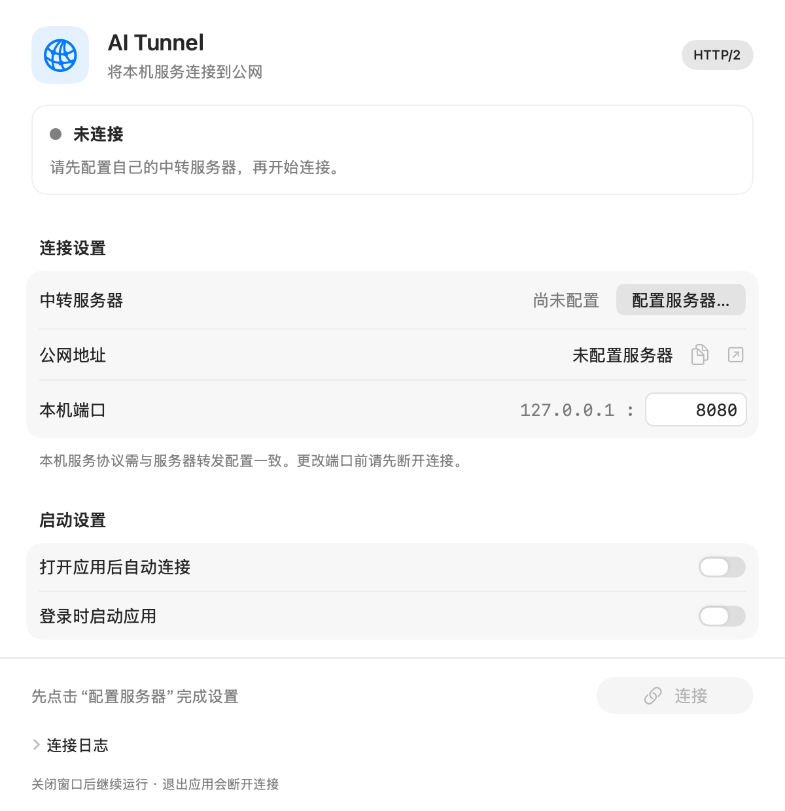
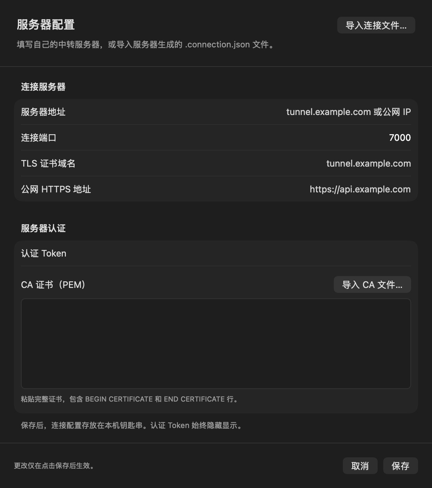

<div align="center">
  
  <h1>AI Tunnel</h1>
  <p><strong>Your Mac service. Your public server.</strong></p>
  <p>A native macOS app for a self-hosted frp + Caddy tunnel.<br>HTTPS / HTTP/2, automatic reconnect, and launch at login.</p>
  <p>
    <a href="https://github.com/yaooort/ai-tunnel/releases/tag/v1.1.0"></a>
    
    
    
  </p>
  <p><a href="README.md">简体中文</a> · <strong>English</strong></p>
  <p>
    <a href="https://github.com/yaooort/ai-tunnel/releases/download/v1.1.0/AI-Tunnel-Public-1.1.0-macOS-arm64.dmg"><strong>Download DMG</strong></a>
    · <a href="#quick-start">Quick start</a>
    · <a href="https://github.com/yaooort/ai-tunnel/releases/tag/v1.1.0">Release notes &amp; files</a>
  </p>
</div>

---

## Interface preview

<table>
  <tr>
    <th width="50%">Main window</th>
    <th width="50%">Server settings</th>
  </tr>
  <tr>
    <td valign="top"><a href="docs/images/main-window.png"></a></td>
    <td valign="top"><a href="docs/images/server-settings.png"></a></td>
  </tr>
</table>

These are offscreen renders of the actual SwiftUI views, with no credentials shown. The app interface is currently in Chinese; this page provides English documentation.

## Features

| Feature | What it does |
|---|---|
| Your own infrastructure | Connects your Mac to a public Linux server you control. |
| HTTPS / HTTP/2 | Caddy provides the public HTTPS endpoint; its local upstream can use HTTP/1.1 or h2c. |
| Native configuration | Enter server settings or import the installer's connection JSON. Saved settings use the current user's Keychain. |
| Connection recovery | frpc reconnects after a lost connection; the app restarts an unexpectedly exited frpc process. |
| Everyday controls | Connect, disconnect, copy the public URL, inspect logs, and enable launch at login. |

```text
Public client → HTTPS / HTTP/2 → Caddy :443
              → HTTP/1.1 or h2c → server 127.0.0.1:18080
              → frp TLS tunnel → Mac frpc → local 127.0.0.1:8080
```

## Download

**AI Tunnel Public 1.1.0** is available for **Apple Silicon Macs running macOS 13 or later**.

| File | Download |
|---|---|
| DMG installer | [AI-Tunnel-Public-1.1.0-macOS-arm64.dmg](https://github.com/yaooort/ai-tunnel/releases/download/v1.1.0/AI-Tunnel-Public-1.1.0-macOS-arm64.dmg) |
| ZIP archive | [AI-Tunnel-Public-1.1.0-macOS-arm64.zip](https://github.com/yaooort/ai-tunnel/releases/download/v1.1.0/AI-Tunnel-Public-1.1.0-macOS-arm64.zip) |
| Checksums | [SHA256SUMS](https://github.com/yaooort/ai-tunnel/releases/download/v1.1.0/SHA256SUMS) |

Open the DMG and drag **AI Tunnel Public** into **Applications**. The public app contains **no preset server, token, or CA configuration**, and uses its own App ID and Keychain namespace.

The app is locally **ad-hoc signed**. It is **not Developer ID signed or notarized by Apple**. If macOS blocks the first launch, allow it in **System Settings → Privacy & Security**.

## Quick start

### 1. Install the relay on your Linux server

Prepare a domain with an **A record pointing to your server's public IPv4 address**. If you use Cloudflare, select **DNS only**. Allow inbound TCP **80, 443, and 7000** in your cloud security group and server firewall; **18080 stays on the server's loopback interface**.

On a **fresh Linux server**, replace `tunnel.example.com` with your own domain and run:

```bash
curl -fsSL https://github.com/yaooort/ai-tunnel/releases/download/v1.1.0/install.sh \
  | sudo sh -s -- --domain tunnel.example.com
```

Omit `sudo` if you are already root. The server must have `curl`; the installer installs the remaining dependencies through a supported package manager. This command uses the fixed **v1.1.0** release rather than the main branch.

The installer verifies the official frp and Caddy archive checksums, installs frps and Caddy, generates a random tunnel token and a private CA/TLS certificate, and sets up startup, process recovery, and certificate renewal. It exports `/root/ai-tunnel.connection.json` with mode `600`, without printing the token.

**The default local backend protocol is HTTP/1.1.** For a local service using cleartext HTTP/2, add `--backend h2c` to the command. See [advanced configuration](#advanced-configuration) for the complete example.

The installer refuses to overwrite existing relay/Caddy configurations or binaries. It does not change cloud security groups or the global firewall.

### 2. Load the server settings on your Mac

Transfer the connection file privately over SSH/SCP, for example:

```bash
scp root@YOUR_SERVER_IP:/root/ai-tunnel.connection.json ~/Downloads/
```

After confirming the transfer, remove the temporary exported copy from the server.

In the app, choose **Configure server (`配置服务器`) → Import connection file (`导入连接文件`)**, select the JSON, then click **Save (`保存`)**. Importing fills the editor; settings are saved only when you click Save.

You can also enter the server address, connection port `7000`, TLS certificate domain, public HTTPS URL, token, and PEM CA certificate manually. The server's mapped port is under **Advanced settings (`高级设置`)** and defaults to `18080`.

### 3. Start your local service and connect

Start your application on **`127.0.0.1:8080`**. Its protocol must match the installer's `--backend` setting. Change the local port in AI Tunnel if needed, then click **Connect (`连接`)**.

For automatic connection after login, enable both **Connect when the app opens (`打开应用后自动连接`)** and **Launch at login (`登录时启动应用`)**.

Closing the window leaves the app running; quitting the app disconnects the tunnel. AI Tunnel does not start your local business service or prevent the Mac from sleeping. Each mapped port on a relay server supports one client at a time. Connection status reports proxy registration; verify your actual business endpoint separately.

## Support matrix

| Component | Supported scope |
|---|---|
| Public macOS download | Apple Silicon / ARM64, macOS 13+ |
| Server CPU | x86_64, ARM64, ARMv7 |
| Automatic service management | systemd or OpenRC |
| Dependency installation | apt, dnf, yum, apk, zypper, pacman |
| Common Linux families | Debian/Ubuntu; Rocky/AlmaLinux/RHEL/Fedora; Alpine; openSUSE; Arch |
| Server requirements | OpenSSL 1.1.1+, Python 3, and network access to GitHub; `curl` is needed to run the download command |
| Containers without an init system | File installation with `--no-start`; manage the processes yourself |

Support covers common Linux environments, not every distribution, older OS, or CPU. Unsupported environments stop with an error.

## Advanced configuration

<details>
<summary><strong>Backend protocol, custom ports, and environment checks</strong></summary>

For a local service that uses **cleartext HTTP/2 (h2c)**:

```bash
curl -fsSL https://github.com/yaooort/ai-tunnel/releases/download/v1.1.0/install.sh \
  | sudo sh -s -- --domain tunnel.example.com --backend h2c
```

Replace `tunnel.example.com` with your domain. The public endpoint still uses HTTPS / HTTP/2; `--backend` selects the protocol from Caddy to the local service through the tunnel.

| Option | Default / purpose |
|---|---|
| `--domain tunnel.example.com` | Your domain; required for installation |
| `--server-address PUBLIC_IPV4_OR_HOSTNAME` | Public IPv4 address or hostname the Mac connects to; defaults to the domain |
| `--backend http1` or `--backend h2c` | Local backend protocol; defaults to `http1` |
| `--frp-port 7000` | frps connection port |
| `--remote-port 18080` | Server loopback port used by Caddy |
| `--no-start` | Install and validate files without starting services |
| `--check` | Detect the environment without installing anything |

Keep client/server ports consistent and allow your chosen frp port through the firewall. The mapped port should remain private to the relay server. The installer requires distinct custom ports in the `1024–65535` range.

To inspect the environment first:

```bash
curl -fsSL https://github.com/yaooort/ai-tunnel/releases/download/v1.1.0/install.sh -o install.sh
sh install.sh --check
```

</details>

## Server maintenance

<details>
<summary><strong>Service status, logs, connection export, and certificate renewal</strong></summary>

**systemd**

```bash
systemctl status ai-tunnel-frps ai-tunnel-caddy
journalctl -u ai-tunnel-frps -u ai-tunnel-caddy -n 100 --no-pager
systemctl list-timers ai-tunnel-cert-renew.timer
```

**OpenRC**

```bash
rc-service ai-tunnel-frps status
rc-service ai-tunnel-caddy status
rc-service ai-tunnel-cert-renew status
tail -n 100 /var/log/ai-tunnel/frps.log /var/log/ai-tunnel/caddy.log
```

**Export another connection file**

The exporter refuses to overwrite an existing destination:

```bash
sudo python3 /opt/ai-tunnel/export-connection \
  --output /root/ai-tunnel-new.connection.json
```

| Location | Contents |
|---|---|
| `/etc/ai-tunnel/relay.json` | Domain, ports, and backend protocol |
| `/etc/ai-tunnel/frps.toml` | frps runtime configuration |
| `/etc/caddy/Caddyfile` | Caddy runtime configuration |
| `/var/lib/ai-tunnel/pki` | Certificates and private keys; back up privately |

Tunnel certificate renewal preserves the CA, so normal renewal does not require a new Mac configuration. systemd checks daily; OpenRC uses a supervised renewal process that checks daily. Caddy renews the public HTTPS certificate automatically.

</details>

## Build and test

<details>
<summary><strong>Public builds, private self-use builds, local deployment, and tests</strong></summary>

### Public Apple Silicon build

Use macOS with Xcode Command Line Tools, a Swift 6 toolchain, and network access to the official frp releases:

```bash
bash scripts/build-public-m1.sh
```

Outputs are written to `dist/public`: DMG, ZIP, checksums, and a verification report. The script builds a fresh app from source without reading `private/` or a personal app bundle. The public Bundle ID is `vip.k-line.aitunnel.public`.

### Private self-use build

The original preset-based workflow is retained:

```bash
# First prepare your own private/ai-tunnel.connection.json
bash scripts/build-macos.sh
bash scripts/package-m1.sh
```

**Apps, ZIPs, and DMGs from the self-use scripts contain preset credentials and must be distributed privately.** Keep them out of public Releases. Publish only the `dist/public` outputs from `build-public-m1.sh`.

### Deploy the server from a source checkout

From the repository root, replace the domain in this command:

```bash
sudo sh deploy/install.sh --source-dir "$(pwd)/deploy" --domain tunnel.example.com
```

This uses the local deployment source without downloading the server payload from a Release. Add `--backend h2c` if your local service requires it.

### Run isolated tests

```bash
./tests/build-harness.sh
'./tests/.build/AppModel Harness.app/Contents/MacOS/AppModelHarness'
```

The 21 isolated test groups use a fake frpc child, temporary directories, and separate Keychain items. They do not connect to the production relay. See the [test documentation](tests/README.md) for coverage and the separate real-connection observation mode.

The optional h2c fixture needs **Go 1.24+**. Building the app does not require Go.

### Third-party components

[frp](https://github.com/fatedier/frp) uses Apache License 2.0. The app build scripts verify the official archives and include the complete frp license with the app; see [Third-party notices](resources/ThirdPartyNotices.txt). The server installs Caddy from [official Caddy releases](https://github.com/caddyserver/caddy/releases).

</details>

## FAQ

**The app says connected. Why is my API unavailable?**

Connected means the proxy was registered. Your local service must still be running on the selected port, using the configured HTTP/1.1 or h2c protocol. Verify an actual business endpoint and its authentication separately.

**How do I use an OpenAI-compatible local service?**

Use `https://YOUR_DOMAIN/v1` as the Base URL. Business API keys are managed by your local service and are separate from the tunnel token. A model list is normally served at `/v1/models`; a `404` response from `/v1` alone does not mean the tunnel failed.

**What has been verified?**

Release validation includes isolated client tests, package/signature checks, Debian and Alpine container installations, emulated Linux ARM64 execution, and an isolated HTTP/2 streaming test with process recovery. See the [Mac package report](https://github.com/yaooort/ai-tunnel/releases/download/v1.1.0/PUBLIC-VERIFICATION.txt) and [server verification report](https://github.com/yaooort/ai-tunnel/releases/download/v1.1.0/SERVER-VERIFICATION.txt). Physical Apple Silicon runtime and physical Linux boot behavior have not been tested; the HTTPS test used an isolated test CA.
