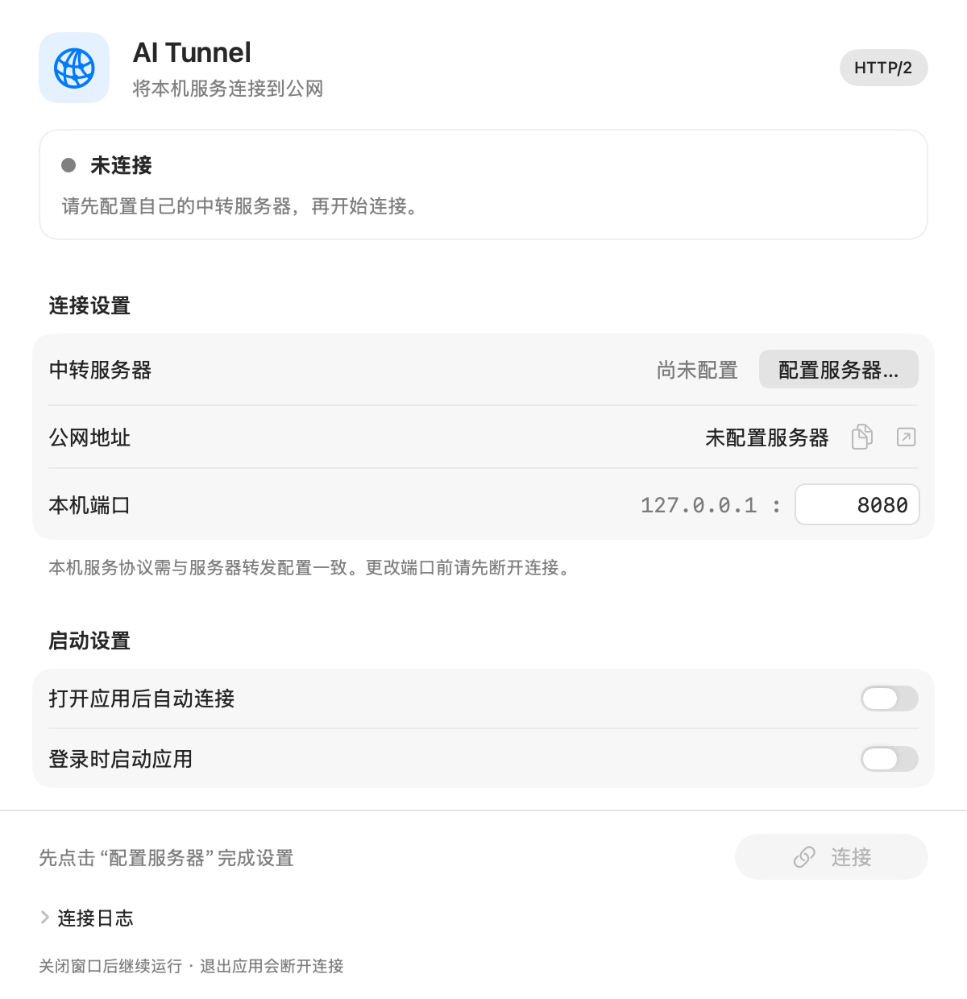
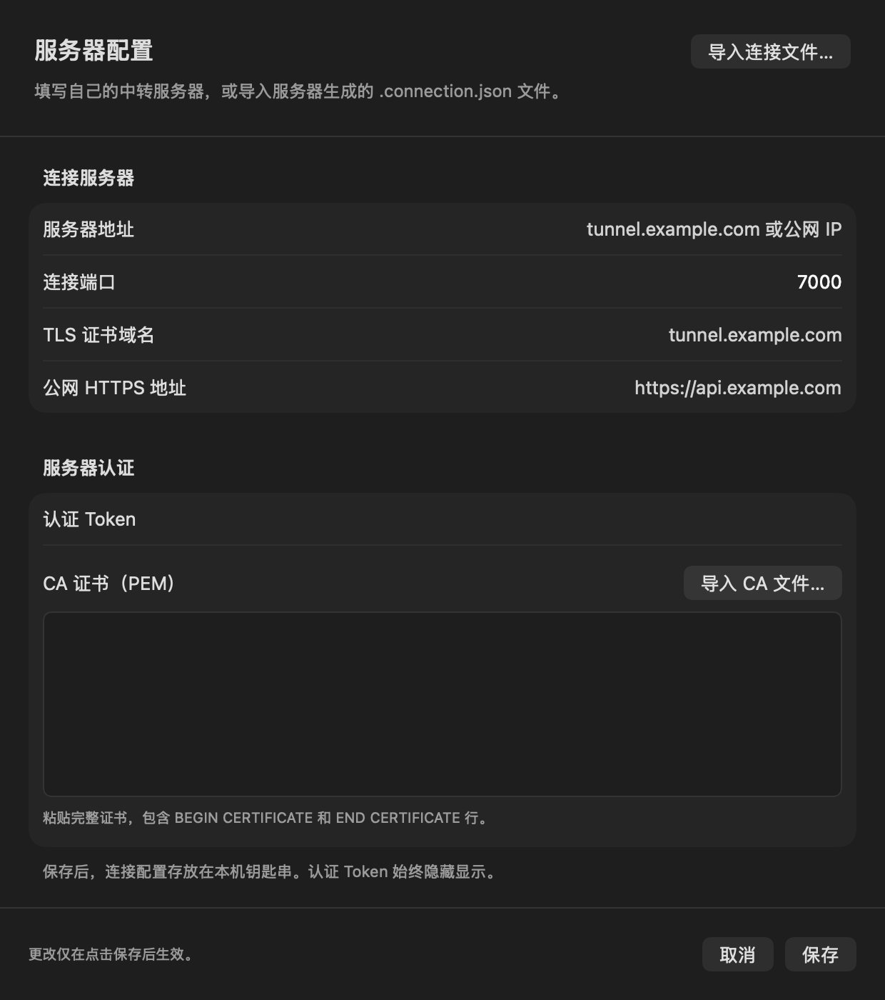

<div align="center">


<h1>AI Tunnel</h1>

<p><strong>让本机服务，通过自己的服务器连接公网。</strong></p>
<p>原生 macOS 客户端 · 自建 frp 隧道 · Caddy HTTPS / HTTP/2</p>

<p>
  <a href="https://github.com/yaooort/ai-tunnel/releases/tag/v1.1.0"></a>
  
  
  
</p>

<p><strong>简体中文</strong> · <a href="README.en.md">English</a></p>

<p>
  <a href="https://github.com/yaooort/ai-tunnel/releases/download/v1.1.0/AI-Tunnel-Public-1.1.0-macOS-arm64.dmg"><strong>下载 M1 / Apple Silicon 安装包</strong></a>
  &nbsp; · &nbsp; <a href="#quick-start">快速开始</a>
  &nbsp; · &nbsp; <a href="https://github.com/yaooort/ai-tunnel/releases/tag/v1.1.0">发行文件与校验</a>
</p>

</div>

---

## 界面预览

<table>
  <tr>
    <td width="50%" valign="top"><a href="docs/images/main-window.png"></a></td>
    <td width="50%" valign="top"><a href="docs/images/server-settings.png"></a></td>
  </tr>
  <tr>
    <td align="center"><strong>连接与启动设置</strong><br /><sub>浅色模式 · 主窗口</sub></td>
    <td align="center"><strong>自己的服务器配置</strong><br /><sub>深色模式 · 配置窗口</sub></td>
  </tr>
</table>

界面图由实际 SwiftUI 视图离屏渲染，展示未配置状态。文档提供中英双语；当前应用界面为简体中文。

## 为什么使用 AI Tunnel

| 能力 | 使用体验 |
| --- | --- |
| 自建中转 | 使用自己的域名和 Linux 服务器，本机无需公网 IP 或路由器端口映射。 |
| 原生 macOS 界面 | 管理连接、本机端口和日志，关闭窗口后仍可从菜单栏操作。 |
| HTTPS / HTTP/2 | Caddy 管理公网证书，后端按需使用 HTTP/1.1 或 h2c。 |
| 自动恢复 | 支持断线重连、隧道进程恢复、登录启动和打开应用后自动连接。 |
| 自己的配置 | 手动填写或导入连接文件，保存到 macOS 钥匙串；公开安装包无预置凭据。 |

<a id="quick-start"></a>

## 快速开始

### 1. 下载 Mac 客户端

| 下载 | 适用场景 |
| --- | --- |
| [M1 / Apple Silicon DMG](https://github.com/yaooort/ai-tunnel/releases/download/v1.1.0/AI-Tunnel-Public-1.1.0-macOS-arm64.dmg) | 推荐：打开后将 **AI Tunnel Public.app** 拖入“应用程序”。 |
| [ARM64 ZIP](https://github.com/yaooort/ai-tunnel/releases/download/v1.1.0/AI-Tunnel-Public-1.1.0-macOS-arm64.zip) | 直接解压使用。 |
| [SHA256SUMS](https://github.com/yaooort/ai-tunnel/releases/download/v1.1.0/SHA256SUMS) | 校验下载文件。 |

要求 **macOS 13+ / Apple Silicon**。当前公开版本使用 **ad-hoc 签名，未进行 Developer ID 签名或 Apple 公证**；首次打开如被阻止，请到“系统设置 → 隐私与安全性”中允许本应用打开。

### 2. 一键安装 Linux 中转

准备一台**全新 Linux 服务器**和自己的域名，将域名 **A 记录**解析到服务器公网 IPv4（Cloudflare 选择“仅 DNS”），放行入站 TCP **80、443、7000**。

把 `tunnel.example.com` 换成自己的域名后执行：

```bash
curl -fsSL https://github.com/yaooort/ai-tunnel/releases/download/v1.1.0/install.sh \
  | sudo sh -s -- --domain tunnel.example.com
```

已经是 root 时去掉 `sudo`。需预装 `curl`，其余依赖由安装器处理。

安装器会校验官方二进制 SHA256，安装 frps / Caddy，生成随机 Token、私有 CA 和证书，并配置启动、进程恢复及证书续期。连接文件写入 **`/root/ai-tunnel.connection.json`**，权限为 `600`。

> 默认本机后端为 **HTTP/1.1**。若本机服务使用明文 HTTP/2，在安装命令末尾追加 **`--backend h2c`**。两种模式的公网入口都支持 HTTPS / HTTP/2。

### 3. 导入配置，连接服务

1. 用 SSH/SCP 私下将服务器的 `/root/ai-tunnel.connection.json` 传到 Mac，随后删除服务器上的临时导出文件。
2. 打开 **AI Tunnel Public → 配置服务器 → 导入连接文件 → 保存**；也可手填地址、端口、TLS 域名、公网 HTTPS 地址、Token 和 CA。
3. 启动本机业务服务，确认监听 `127.0.0.1:8080` 且协议与中转配置一致，然后点击 **连接**。
4. 需要登录后自动恢复时，同时开启 **登录时启动应用** 和 **打开应用后自动连接**。

关闭窗口会继续运行，退出应用会停止隧道。电脑睡眠或业务服务停止时，公网业务不可用；应用不会自动启动你的业务程序。

## 支持范围

| 项目 | 支持情况 |
| --- | --- |
| 公开客户端 | Apple Silicon / ARM64，macOS 13+ |
| Linux 架构 | x86_64、ARM64、ARMv7 |
| 服务管理 | systemd 或 OpenRC；无 init 的容器可用 `--no-start` 后自行管理进程 |
| 包管理器 | apt、dnf、yum、apk、zypper、pacman |
| 常见发行版 | Debian / Ubuntu、Rocky / AlmaLinux / RHEL / Fedora、Alpine、openSUSE、Arch |
| 服务端依赖 | OpenSSL 1.1.1+、Python 3、可访问 GitHub 的网络 |
| 已有服务器 | 检测到现有中转 / Caddy 配置或相关二进制时拒绝覆盖 |

安装器面向上述常见环境，无法覆盖所有 Linux 发行版、旧系统或 CPU。它不会修改云平台安全组或全局防火墙。

<details>
<summary><strong>进阶配置 · 端口、后端协议与调用链路</strong></summary>

### 安装参数

| 参数 | 默认值 | 含义 |
| --- | --- | --- |
| `--domain` | 必填 | 用于公网 HTTPS 和隧道证书的域名 |
| `--server-address` | 同域名 | Mac 连接的服务器地址，可填写公网 IPv4 或域名 |
| `--backend` | `http1` | 本机业务协议，可选 `http1` / `h2c` |
| `--frp-port` | `7000` | Mac 连接 frps 的端口，需公网放行 |
| `--remote-port` | `18080` | 服务器回环映射端口，需与客户端配置一致 |
| `--check` | — | 只检测环境，不安装 |
| `--no-start` | — | 生成并校验文件，不启动服务 |

`18080` 仅监听 `127.0.0.1`，无需对公网开放。同一服务器映射端口只供一个客户端占用。
安装器要求自定义的两个端口不同，且均在 `1024–65535` 范围内。

```text
公网调用方
  └─ HTTPS / HTTP/2 → Caddy :443
       └─ HTTP/1.1 或 h2c → 127.0.0.1:18080
            └─ frp TLS 隧道 → Mac frpc
                 └─ TCP → 127.0.0.1:8080
```

本地源码部署也可运行：

```bash
sudo sh deploy/install.sh --source-dir "$(pwd)/deploy" --domain tunnel.example.com
```

</details>

<details>
<summary><strong>服务端维护 · 状态、日志、证书与重新导出</strong></summary>

### systemd

```bash
systemctl status ai-tunnel-frps ai-tunnel-caddy
journalctl -u ai-tunnel-frps -u ai-tunnel-caddy -n 100 --no-pager
systemctl list-timers ai-tunnel-cert-renew.timer
```

### OpenRC

```bash
rc-service ai-tunnel-frps status
rc-service ai-tunnel-caddy status
rc-service ai-tunnel-cert-renew status
tail -n 100 /var/log/ai-tunnel/frps.log /var/log/ai-tunnel/caddy.log
```

### 重新导出连接文件

```bash
sudo python3 /opt/ai-tunnel/export-connection \
  --output /root/ai-tunnel-new.connection.json
```

导出不会覆盖已存在的目标文件。域名、端口和后端参数保存在 `/etc/ai-tunnel/relay.json`，运行配置为 `/etc/ai-tunnel/frps.toml` 与 `/etc/caddy/Caddyfile`。

私有 PKI 位于 `/var/lib/ai-tunnel/pki`，需私下备份。systemd 或 OpenRC 定期检查隧道证书续期，保留原 CA，正常续期无需修改 Mac 配置；公网证书由 Caddy 自动续期。

</details>

<details>
<summary><strong>开发者 · 从源码构建与运行测试</strong></summary>

需要 macOS、Xcode Command Line Tools（Swift 6）及官方 frp 下载网络。

### 构建无预置凭据的公开 M1 版

```bash
bash scripts/build-public-m1.sh
```

产物位于 `dist/public`：DMG、ZIP、校验清单和验证报告。公开版 Bundle ID 为 `vip.k-line.aitunnel.public`，使用独立钥匙串空间。

### 运行隔离测试

```bash
./tests/build-harness.sh
'./tests/.build/AppModel Harness.app/Contents/MacOS/AppModelHarness'
```

21 组测试使用假的 frpc、临时目录和独立钥匙串项，不连接生产中转。详见 [测试说明](tests/README.md)。可选 h2c fixture 要求 Go 1.24+，普通 App 构建不需要 Go。

### 原免导入自用构建

```bash
# 先准备自己的 private/ai-tunnel.connection.json
bash scripts/build-macos.sh
bash scripts/package-m1.sh
```

这些自用产物**含预置凭据，只能私下分发**。公开 Release 仅使用 `build-public-m1.sh` 的 `dist/public` 产物。

</details>

## 常见问题

**“已连接”，为什么业务请求仍然失败？**

这个状态表示 frp 代理注册成功。还需确认本机服务已启动、端口正确、HTTP/1.1 或 h2c 协议匹配，并请求真实业务路径。

**怎样连接 OpenAI 兼容服务？**

客户端 Base URL 通常填写 `https://你的域名/v1`，模型列表为 `/v1/models`。业务 API Key 由本机服务管理，独立于隧道 Token；直接访问 `/v1` 返回 404 不代表隧道故障。

**有没有经过验证？**

客户端隔离测试、打包验签、Debian / Alpine 安装、Linux ARM64 容器执行、HTTP/2 流式响应及异常退出后恢复均已验证。详细边界见 [发行验证报告](https://github.com/yaooort/ai-tunnel/releases/tag/v1.1.0)：未做 M1 实机运行或 Linux 物理机开机验收。

## 第三方软件

[frp](https://github.com/fatedier/frp) 使用 Apache License 2.0，完整许可随 App 分发，详见 [第三方说明](resources/ThirdPartyNotices.txt)。服务端使用 [Caddy 官方发行包](https://github.com/caddyserver/caddy/releases)。

<p align="center"><sub>自己的 Mac · 自己的服务器 · 自己的公网入口</sub></p>
